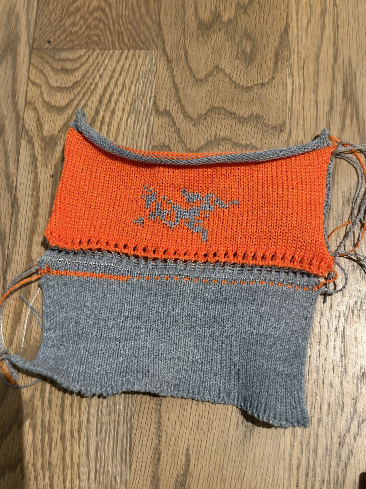
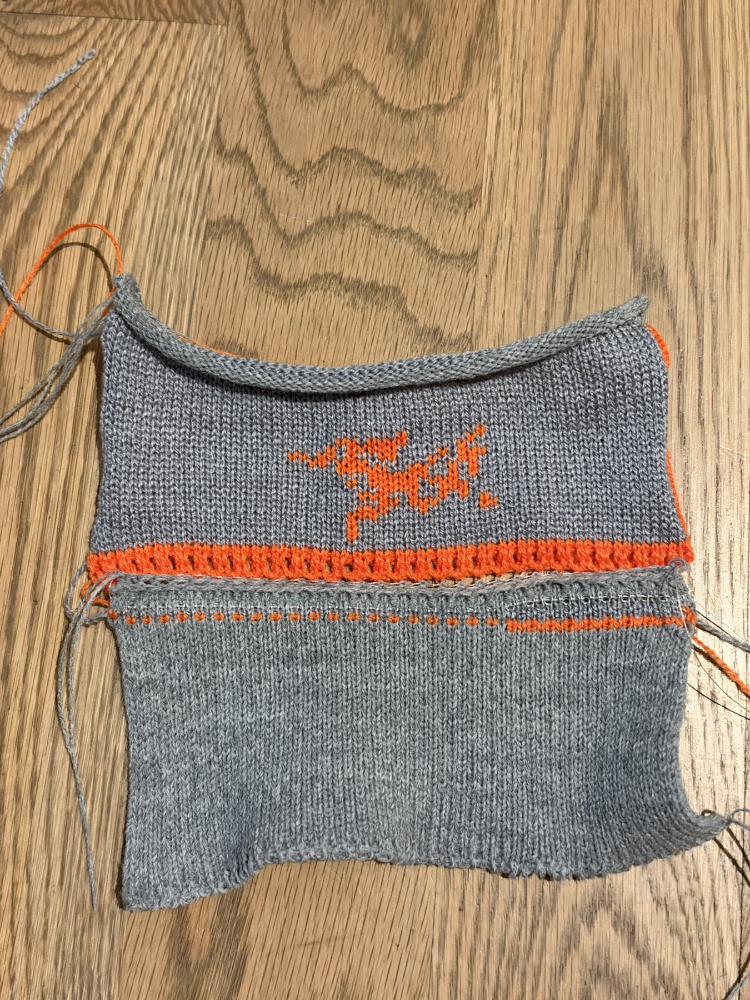

# Issue #9: physical results and outstanding design requirements

These are development records, not ready-to-knit releases. No production or
physical qualification is claimed. **Reversible v2 completed, but its main-yarn
cast-on needs redesign. Do not repeat it unchanged to test that edge.**

## Evidence and status

| Trial | Physical result | Exact evidence |
| --- | --- | --- |
| Run 1 and original Run 2 | Yarn mismatch/transition breakage; Run 2 stitch sizes improved; initial C6/C1 catches had problems | [Original report and IMG_1009–1011](https://github.com/xjhc/kniterate-studio/issues/9#issuecomment-6711473394) |
| Earlier Run 3, all-speed-100 hybrid | Neat 2x2 cast-on, good needle movement; left waste/right jacquard edge drops, tiny bird, stiff crown | Same report; SHA `ecb46fb62d0aaa3672b7efcf16de1de7715d536c94ccb4fc5f3ec5ed6b14f60c` |
| Run 2, handoff 2 (~355 KB) | Best fabric so far; first main-yarn row frayed at bottom left; return edge loose | [Report and reference comparison](https://github.com/xjhc/kniterate-studio/issues/9#issuecomment-6728033787) |
| Run 4B, first cast-on roller 300 | Main yarn broke at first left-to-right return during knitting; bind-off mostly worked but broke yarn at its right-hand start | [Exact project and KC](./run4b/); [report, pass trace, and IMG_1177](https://github.com/xjhc/kniterate-studio/issues/9#issuecomment-6728492623) |
| Straight birdseye panel | Prepared; no physical result reported for this exact candidate | SHA `f42d859de30a24e3df29dbe224fc58da2cf71f1393c8ea8ee71c62a6a228e2cb` |
| DBJ edge-decrease study | Software checked, physically untried; eight steps, 62 to 46 columns per bed; not a rounded crown or reversible recipe | [Input and receipt](./dbj-decrease-study/) |
| Reversible v1 | Aborted: C1 missed its first arrival from the left, C6 tangled; C3 caught the oldest waste row | [Input, exact KC and receipt](./reversible-v1/); [diagnosis](https://github.com/xjhc/kniterate-studio/issues/9#issuecomment-6729199930) |
| Reversible v2, Run 2 startup + left-loop refresh | Completed rectangle; C1 caught successfully, previous startup issue not observed; open cast-on edge and orange reverse setup band remain | [Input, exact KC and receipt](./reversible-v2/); photos below |

The issue's old “v2 physical validation pending” statement is superseded by this
result. The earlier “Run 4 not knitted” statement is likewise superseded by Run 4B.
Distinct file hashes must not be combined into one passing run.

## Reversible v2: operator observations

- The result is a **reversible rectangle**, not a finished or fitted beanie.
- The orange lower edge has regularly spaced holes, described as missed stitches
  or a yarn-over-like edge. This appearance is unacceptable.
- About four orange rows appear on the grey reverse before its grey fabric starts.
  The operator clarified: **one orange joining row on the grey side is acceptable**;
  the open edge is the primary objection. Both outward faces should show knit stitches.
- The faces appear as separate layers. The operator asks whether this matches
  Kniterate's reversible construction; body selection and edge closure must be
  distinguished, rather than claiming complete equivalence to the official app.
- The previous Run 2 startup break was not observed in this trial. C1 succeeded
  with the existing draw yarn. This is one successful observation, not proof that
  the Run 2/4B breaks or every C1 failure are solved.
- The operator questioned why the cast-on was chosen without explaining or
  discussing its appearance. Reusing an available recipe was an implementation
  shortcut, not evidence of a suitable finished edge.

Conditions: C3 orange and C4 grey, one strand of 2/14 acrylic each; C6 two strands
of 2/30; existing C1 draw yarn. 62 columns per bed, 32 design rows, bird 21x16.
No rib, decreases, or machine bind-off. Eight top waste rows per bed support
off-machine finishing. Fit and finished gauge remain unmeasured.

Exact completed KC: 302,567 bytes, 250 passes,
SHA-256 `846cabf253ab25a42efe38c17583717c39e3d952075b984a474e11aa74f193c0`.





## What the command trace establishes

The shared Run 2 prefix was adopted with an explicit rear-left catch-loop repair.
Previously, a C6 loop made on pass 2 survived until the first main carrier caught
it. Refreshing that needle prevents this particular old-loop attachment.
The unmodified shared routine reproduces the frozen Run 2 prefix exactly; the
candidate comparison permits the documented refresh and resulting omission of two
empty release moves, after width/carrier adaptation.

C1's catch remains speed 100, stitch 5, roller 400. Other changes include Run 2's
waste structure, stitch 4, speed profile, and waste length. These changes plausibly
improved waste control, but their individual physical contributions are not isolated.
Keep this successful startup as the comparison baseline; do not change C1 thickness
or feeder geometry on the assumption that its earlier misses proved either wrong.

The later beanie cast-on was retained, not replaced by Run 2's fairisle cast-on:

| V2 pass (file, 1-based) | Main-yarn operation |
| --- | --- |
| 122 | C3 leftward, 31 front + 31 rear, stitch 4; rear needles initially empty |
| 123–124 | C3 front then rear circular rows, 31 needles each, stitch 6 |
| 125 | C3 full-bed fill, 62 front + 62 rear, stitch 7, rack 0.5, roller 100; **31 empty needles on each bed** |
| 126–127 | C3 full front then full rear row, stitch 7, roller 700 |
| 128 / 130 | First design C3 front / C4 rear passes |

Four orange rear-bed setup stages precede the grey reverse. The band is programmed,
not colour leakage. The regularly spaced openings are consistent with expanding
an alternating-needle start onto empty needles, not evidence of a deliberate lace
design. Photos do not prove every individual loop's formation.

The earlier successful hybrid was **2x2 rib → birdseye jacquard**, then a
single-jersey shaped crown. Its rib loops were transferred to populate all 62 front
needles before the double-bed fill: zero empty front needles, 62 empty rear needles.
V2 instead fills 31 empty needles on each bed, including the visible front.
Rib contraction could also reduce visible gaps, as the operator suggested, but
the two starts are topologically different. The earlier rib result did not qualify
this direct reversible start.

Complementary body selections create stockinette on both faces; layers can separate
in solid areas and exchange yarns at motif boundaries. Dedicated side-edge closure
is not implemented in this recipe. Kniterate documents both [Invert colors and
separate Close border options](https://support.kniterate.com/hc/en-us/articles/11677450326173-BIRDSEYE-JACQUARD).
Matching the inverse-selection principle does not establish identical starts or borders.

## Requirements carried forward

1. Preserve successful sections. Redesign the main-yarn start for a deliberately
   closed edge; do not present the current open start as acceptable or ready.
   Explain the visible edge and any joining colour before the next physical trial.
2. No unwanted 2x2-rib-to-jacquard transition for this all-jacquard direction.
   Straight development first; rounded shaping later. Decreases remain a separate,
   unknitted experiment, not silently included in reversible v2.
3. Every live top stitch must have waste support before release. Expecting the
   operator to catch unsupported live stitches after release is impractical.
4. Preserve Run 2's introduction approach where requested, verifying the connecting
   needle/carrier state. Do not set every pass to 100 when asked to match Run 2.
   V2 restores Run 2 startup speeds; its later body/finish remain at 100.
5. Keep the enlarged motif (original 12x10 was too small; later candidate 21x16),
   while exposing deliberate scale choices and using measured gauge for fit claims.
6. Track first-main-row breakage, turning-edge looseness, waste/jacquard edge drops,
   stiff crown, and bind-off starting-edge yarn break separately. No global tension,
   speed, stop-distance, or yarn-thickness diagnosis has been established.
7. Changes must come from our compiler and reproducible inputs, not instructions
   to change Kniterate Design App settings or undocumented hand edits to KC.
8. Before each trial, state the exact change, expected fabric on both faces,
   uncertainty, successful baseline, and learning objective. Prefer a small targeted
   trial when it answers the question. Do not repeat unchanged failures or imply
   that software checks establish physical reliability or appearance.
9. Design discussion should be concise and informed by construction/garment tradeoffs,
   not obvious front/back definitions or restricted to this bird beanie. The operator
   wants to expand ideas. Use working product links and visible backing evidence.
   Guest In Residence's Wild Rag was a useful reversible reference; the RRL cardigan
   was rejected aesthetically and as insufficient evidence of its backing.

## Reproducing the archived experiments

Run from the repository root with the pinned Node/pnpm versions. The preparation
scripts accept paths; they do not require the original Mac workspace. A starting
hybrid project and frozen Run 2 reference are already tracked in `apps/studio/public/handoff-2/`.

```sh
mkdir -p output/issue9-reproduction
node --import tsx scripts/prepare-straight-mini.ts apps/studio/public/handoff-2/3-mini-toque/project.kniterate-studio.json output/issue9-reproduction/straight.json
node --import tsx scripts/prepare-reversible-beanie.ts output/issue9-reproduction/straight.json output/issue9-reproduction/reversible-v1
node --import tsx scripts/prepare-reversible-beanie.ts output/issue9-reproduction/straight.json output/issue9-reproduction/reversible-v2 --run2-startup apps/studio/public/handoff-2/2-studio-fairisle/program.kc
node --import tsx scripts/prepare-dbj-decrease-study.ts output/issue9-reproduction/straight.json output/issue9-reproduction/decrease
```

Generated manifests describe software checks on a candidate; the archived receipts
and this record carry the physical outcomes. Compare KC hashes before associating
a generated file with any result. Do not overwrite the physical evidence with a
fresh generation manifest. The archived `study-input.json` files record the exact
builder inputs; the source Studio project describes birdseye and its UI export
does **not** reproduce the experimental reversible or decreased variants.
