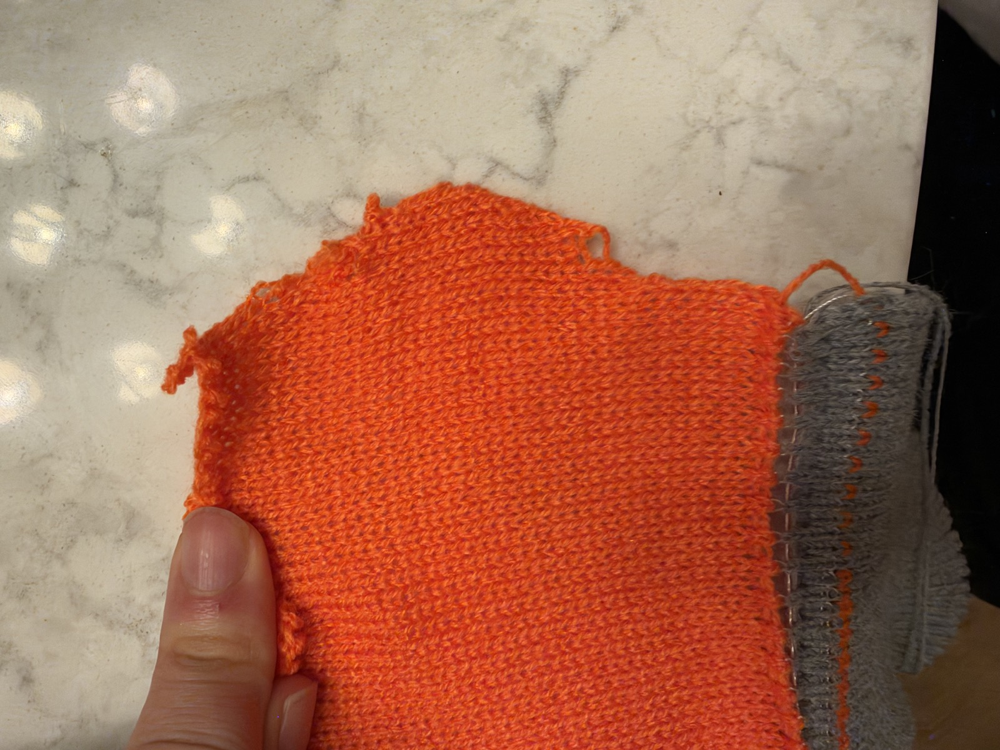

# Increase-method comparison strip — stopped by operator

Report received 2026-11-11. Candidate: 538-pass partner gist, SHA-256 `6787c4c51481ec9e9ffcf141789310ddf061b7d6638f21ba9f83b32dfceba6a6`. Copied to SD and hash-verified before this run. Exact stop pass and band were not reported.

## Operator feedback, verbatim

> had to stop it. post photo with this on gh. the increase was ~ok except it missed the last loop. the decrease (i guess its doing fashion decrease?) was bad. also i think the swatch can be smaller. put feedback on gh

## Interpretation and follow-up

- Run stopped; do not record this as a successful or fully completed four-band comparison.
- Increase was approximately acceptable to the operator, except for a missed last loop. The report does not identify which increase style/band was reached; do not infer that lifted-bar increases were tested or passed.
- Decrease was unsatisfactory. The partner's specification uses the same three-edge-stitch inward/fashioned decrease in all bands. This is a single-bed construction, different from the paired cross-bed decrease in the earlier reversible diamond that looked satisfactory.
- Photo shows loose/protruding loops and an irregular sloped edge; exact mechanical cause is not established from the photograph.
- Operator asks for a smaller swatch. Reduce the test body and isolate the edge/decrease problem before another long four-band run. Preserve adequate startup waste/take-down support rather than shortening it indiscriminately.
- Stop pass, last completed band, exact missed needle and any interventions are not recorded. No new file or correction issued with this feedback.

Photo IMG_1187.HEIC supplied by operator; JPEG display copy included with explicit permission to publish the photo on GitHub.

