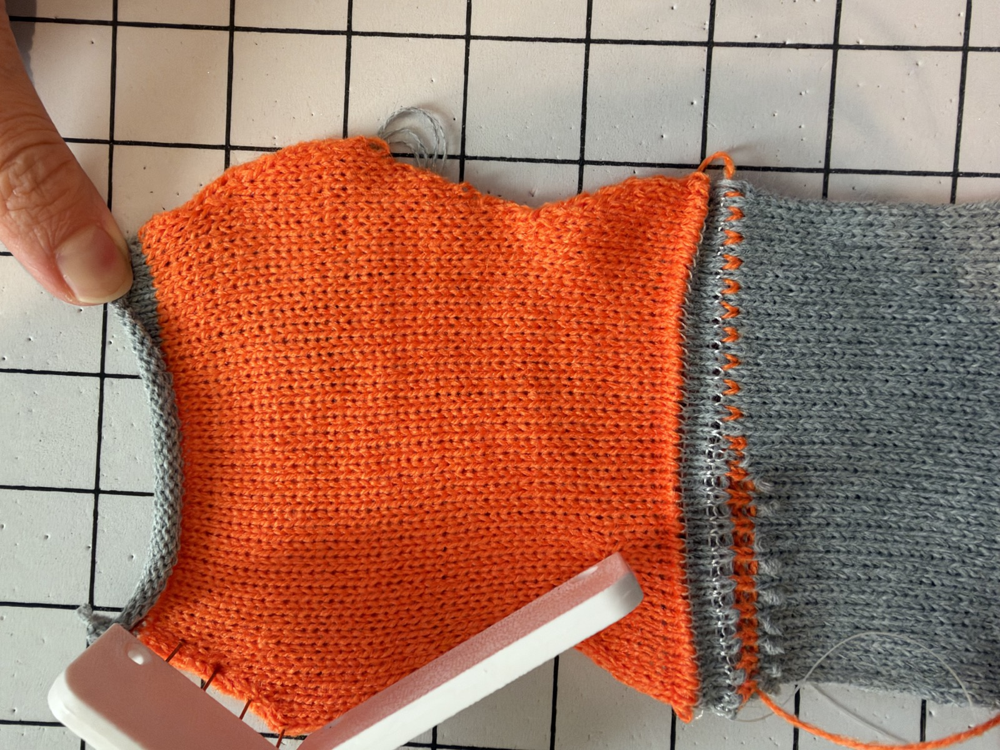
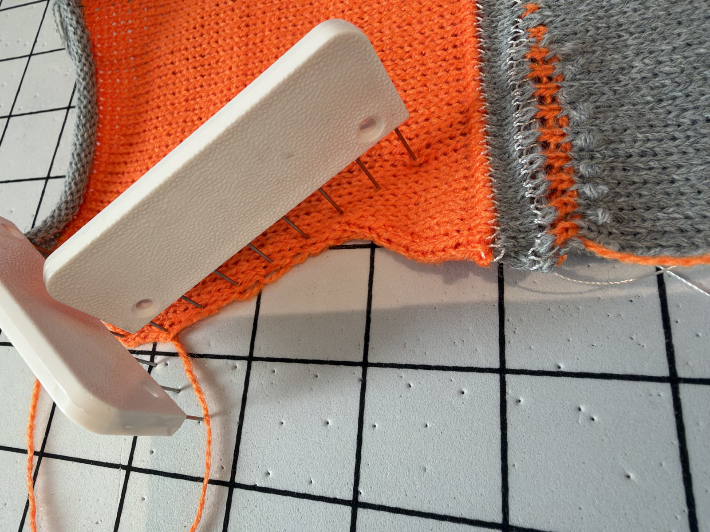

# Edge diagnostic — operator-reported success

Report date: 2026-11-12. Exact run times not recorded.

> this test knit was successuful on dec/inc and main yarn cast on part

Follow-up:

> also tell me how the dec/inc is changed, i wnat to understand what makes succesful fasioned dec

Exact candidate: 268 passes, 325360 bytes, SHA-256 `2c5ef66ef99610d933f9fbdf7998d6dad242e67402ad06ba61201684ee72a8ac`. SD hash verified before ejection. Preserved machine source/output, instructions, software receipts and both supplied photographs.

Operator reports success for increases, decreases and main-yarn cast-on. Photos show the shaped orange jersey specimen, bottom grey waste/draw boundary and top grey waste; parts of one edge are held/obscured by blocking tools. No per-event ranking, stop/intervention log, relaxed dimensions, gauge or machine details supplied. Do not infer zero stops or promote automatically to formal Knit-proven status. This is physical evidence for this single-bed candidate, not reversible increases or lifted-bar/split methods.

## What changed from the failed 538-pass strip

- Shorter diagnostic: 46 body rows rather than 158. Both edges are tested rather than only the right.
- First narrow before widening, then repeat narrowing after widening. This separates edge support conditions more directly.
- Each narrowing section tests two one-loop-at-a-time decreases, then two grouped three-edge-stitch decreases. The grouped version is parity-separated into 2+1 needle selections, not three adjacent needles all transferring in one pass.
- Both variants move the three outer stitches inward and merge with the neighbouring stitch, then knit through the merged loops. The sequential version temporarily parks the inner neighbouring loop, shifts edge loops individually through the rear bed, then restores the parked loop onto the inward edge loop. Eight transfer passes per edge versus four for the grouped method.
- Increases remain plain outer-needle additions, not fashioned/lifted-bar/split increases. New needles are tested first and last in the yarn's travel, with direction reversed across the widening section.
- Our subsequent cast-on revision replaced alternating 1x1 occupancy with the full-needle single-bed-reference construction, including supporting waste/draw and the reference first jersey row. Remaining shaping passes match the partner's 274-pass edge trial exactly. This does not isolate the cast-on as the cause of success versus the older failed strip.

## Meaning and next step

A successful fashioned decrease needs the old loops to be captured, retained through rear-bed transfer/racking/return, and knitted through at the merged destination. Sequential moves are a plausible way to reduce simultaneous disturbance, but this run also includes grouped moves and no per-method ranking was supplied. Do not claim grouped decreases fail universally or that sequential moves alone caused success.

Next proposed trial: a SMALL two-colour reversible right-edge slope, fixed joined left edge, slow +1/-1 shaping schedule and a few events. Use the official reversible sleeve's precise increase colour choreography (one empty rear needle per yarn pass, old edge column swaps colours), not the unverified split or lifted-bar paths. Keep the successful reversible decrease as baseline, ensure C1/C6 remain outside the working envelope, verify actual yarn-path joins, and measure body-only gauge. The single-bed rear-to-front cast-on collapse cannot be copied unchanged into a fabric needing live loops on both beds. Preserve this new start as the single-bed baseline and validate a two-bed start separately.

