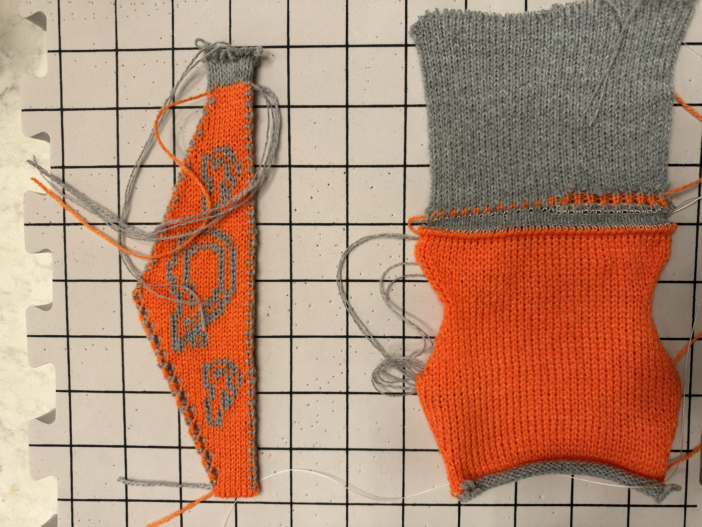

# Two physical samples — photo feedback, 2026-11-12

Operator request: “here is the photo of the two, let's put feedback on github. summarize what happened, what you think is going on, and how do we want to go”. Supplied photo: IMG_1212.HEIC, converted to JPEG for viewing. Photo shows one face of each specimen, laid sideways; this is not a two-face inspection of the reversible specimen.

## Identification and what happened

The upper orange/grey paisley specimen visually matches the last issued reversible candidate: original small / simplified large / original small, equal two-design-row motif gaps, 8 → 21 → 8 columns, 81 design rows, 13 right-only increases and 13 decreases every three design rows. The machine-left edge stays fixed. C3 orange and C4 grey are single strands of the previous 2/14 acrylic; body stitch 7. This is not a 2/30 merino raglan trial.

Latest issued file SHA-256: `0be718de93c415b51ccb859d013a5578f4ff8c2e8cfffc0ce4bd380ee495acd3`, 522 passes, 635356 bytes. Local SD receipt confirms this exact file was copied as command.kc, hash checked and card ejected. Earlier candidate instructions saying “No SD copy performed” describe their preparation-time state; this receipt supersedes that status. Association of the photographed specimen with this file is based on appearance and last-issued provenance, not a fresh operator confirmation of the run hash.

The lower orange jersey specimen appears to be the earlier single-bed edge diagnostic with grey waste, previously reported successful for cast-on/increases/decreases in this issue. Its exact identity is inferred from appearance/history. It must not be read as the reverse face of the paisley specimen.

## Visible evidence

- Upper sample has all three motifs, a continuous-looking straight edge and two continuous-looking sloping sections meeting at the widest point. No gross ladder/run is obvious in this view; that does not exclude individual missed stitches.
- Alternating orange/grey loops form a prominent chain-like border on the straight and shaped edges. The shaped edge is visibly stepped, with locally open/elongated-looking loops. Loose yarn tails obscure some central detail; these are not evidence of dropped stitches by themselves.
- Lower sample shows orange single-bed jersey, shaped sections and grey waste. Its border and thickness are structurally different, so this is not a controlled comparison of two increase methods.
- We cannot establish both-face loop capture, resistance to side separation, relaxed gauge, stop-free operation, or event-specific increase/decrease quality from this photograph. No new operator claim of zero stops or complete success was supplied with it. No formal Knit-proven promotion.

## Interpretation — hypotheses, not a confirmed defect diagnosis

The contrasting border is consistent with the intentionally alternating-colour cross-bed joins. Some edge bulk/colour mixing is expected from that construction; it should not automatically be called a missed stitch. The stepped outline is consistent with changing one column every three design rows. This visible border motivates the separate tasteful-trim work in #19.

The reversible increase still borrows the rear edge loop to the new front column and follows the reference-derived colour choreography: each yarn makes one empty rear-needle pickup. It is NOT a split or loop-supported fashioned increase on both beds. New-loop pickup, yarn tension and local take-down can plausibly explain an elongated/open-looking increase edge, but the photo cannot isolate which factor dominates or locate a failed event reliably.

The reversible decrease transfers outgoing front/rear loops inward onto opposite-bed occupied needles, then knits through the merged stacks. It is NOT the three-edge-stitch fashioned single-bed decrease from the lower diagnostic. That successful single-bed construction cannot simply be applied unchanged when the rear bed already carries the second face.

## Proposed direction

1. Preserve this candidate and photograph as the current baseline. Inspect the reverse face and gently check both side joins; record any missed loops, interventions/stops and whether C1/C6 stayed clear. Use the candidate event map for any direction-specific fault. Measure washed/relaxed body gauge excluding waste; grid spacing in this photo is not a supplied measurement.
2. If capture and joins are sound, keep this shaping mechanism as a provisional physical baseline and make the next small comparison about edge appearance: the existing alternating join versus a narrow, consistently coloured joined trim. Keep the same yarn, stitch setting and shaping cadence initially. Design and verify trim ownership through increases/decreases so decoration does not break the required loop/colour sequence; then trial it. This is proposed work, not a new validated export.
3. If a missed/open increase is confirmed, first isolate that event/direction with the current construction before adding trim or changing gauge. Do not label the issue fixed merely because software loop checks pass. Do not substitute unverified split encoding.
4. After edge reliability and appearance are accepted, scale the scarf from measured gauge. The merino raglan remains a separate single-bed project requiring its own two-strand yarn/gauge swatch.

No compiler, program, SD contents or physical-proof registry changed with this report.

