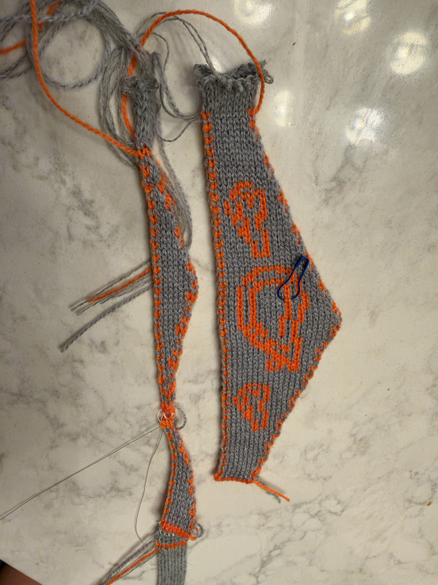
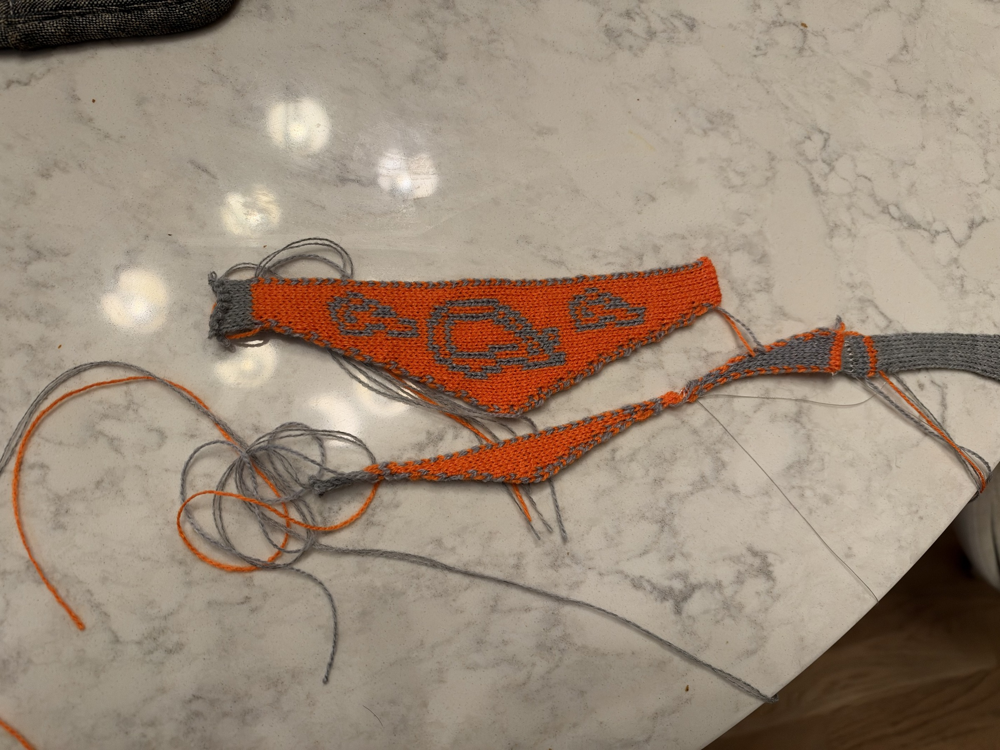

# Joined paisley and two-column tip swatches, 2026-11-22

## Operator feedback

1. The joined paisley is still imperfect and is the best increase result so far. Keep the joined version as the baseline. The operator opted to skip the open-edge comparison.
2. The widening edge could be tighter. Explore shorter loops only if the change can be made safely.
3. The two-column point knitted. It looks too sharp and may be fragile. Use three columns at each end for the full scarf. The photos establish that the two-column construction made a specimen. Durability and repeatability remain to be measured.

## Files and photos

| Swatch | Passes | SHA-256 |
|---|---:|---|
| Joined paisley, grey makes all 13 increases | 510 | `2c85e52672cc19100a882c1f2feaf8d7cf3b83bf471fa00c010dd54589709aac` |
| Tip trial, 2 → 8 → 2 columns | 378 | `3ea65875e829afc7b406a6a12d3270cc33e16c6f498af6c921dab04ef357b5c1` |

The operator supplied both faces of the two latest knits. IMG_1263 shows the grey faces and the tip starter still attached. IMG_1264 shows the orange faces. The blue marker in IMG_1263 does not establish the machine pass of any stitch. The photos show the shaped edges and contrasting join stitches. The cause of the remaining looseness was not isolated.

## Shorter increase loops

The 510-pass baseline knits the body and splits at stitch size 7, speed 200, and body take-down 450. The separate transfer uses speed 100, stitch setting 5 and take-down 0. In the first increase the split shares a pass with body knitting (passes 125 and 130), and the right outer join has its own one-stitch pass at 128.

An offline check reproduced the published file byte for byte and tested placing a smaller stitch setting on the first split only. The converter changed the front and rear stitch-size arrays for that pass, including both split needles. Pass count and knit and transfer operations were unchanged. This establishes that the converter can encode the change. It does not establish whether the loop will clear or the yarn and needle can handle it.

Keep size 7 for the scarf baseline. If a supervised comparison is warranted, first identify whether the extra loop length is in the split or edge join. Then check a small, single-variable comparison against the same yarn and width, at slow speed, after checking how the controller applies the setting at both split needles. Leave yarn feed, take-down and transfers at the baseline for that comparison. Inspect for missed capture, yarn strain and edge puckering before considering a change for the scarf. A tighter edge can also depend on where the loop is borrowed and on how the layers turn at the edge.

[Kniterate stitch-size guidance](https://support.kniterate.com/hc/en-us/articles/360019551738-Adjusting-the-stitch-size) · [Kniterate roller guidance](https://support.kniterate.com/hc/en-us/articles/360019405297-Adjusting-the-rollers)

## Product update

Use three-column ends for the full-size draft and keep the joined reversible selvedge. With the measured acrylic swatch gauge of 21 columns across 5.5 cm and 81 rows over 18 cm, the Fig / Camel chart remains 223 columns × 729 rows, with 220 increases over 364 row transitions in the widening half. Test the three-column finish and the faster slope. Recalculate after swatching the final yarn. Full-size machine export is pending.
