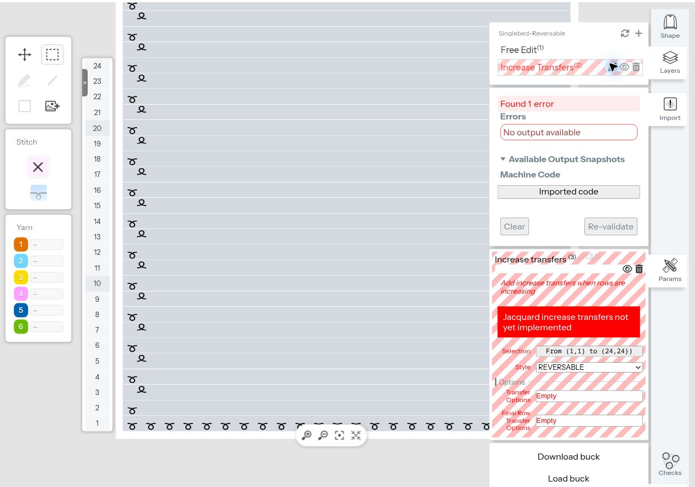

# Additional controlled Customist captures

21 production-browser exports captured on 2026-11-13. These address the
follow-up capture list, without changing Studio's emitter or converter.
Run `python fixtures/customist-debug/2026-11-13-followup/verify.py` from the
repository root. The manifest pins inputs, raw downloads, editable command
stacks, decoder reports and account-header-free screenshots.

## Findings

| Comparison | Captures | Observed result |
| --- | ---: | --- |
| Simple on the existing jacquard base | 1 | Exports 116 passes, including two front-to-rear split operations with C4. The untreated control has 100 passes. This is not a blanket fabric refusal. |
| REVERSABLE on the existing single-bed base | 1 | Same “Jacquard increase transfers not yet implemented” error as the earlier jacquard test. The 24-pass export equals the untreated single-bed control except the filename comment. |
| One-colour 1×1 rib: control/Simple/REVERSABLE | 3 | Control has both beds on every row. Simple exports 38 passes with two front-to-rear splits; REVERSABLE refuses and exports the unchanged 24-pass control. |
| Both edges widening: control/Simple/Fashioned | 3 | Both styles accept a full-canvas selection. Simple has 40 passes, with two splits together at passes 8 and 24; Fashioned has 48 passes, with two together at passes 8 and 28. |
| Left/right single-bed decreases: control/Simple/Fashioned | 6 | Controls have 24 passes; Simple has 28 and Fashioned 36. Both sides emit transfers. |
| Jacquard decreases: control/Simple/Fashioned/REVERSABLE | 4 | 100/104/112/104 passes respectively. All three styles emit transfers. REVERSABLE decrease is implemented for this input and differs from Simple; do not conflate it with REVERSABLE increase. |
| Fashioned width 2 | 1 | 32-pass export differs from the earlier width-4 case; exact selected width is in the source and screenshot. This alone does not prove every intermediate width rule. |
| Start/body/top waste: Retract Feeders off/on | 2 | 158 passes each; all instructions are identical except the filename comment. C6 returns to knit eight full front-bed rows at passes 145–152, followed only by carrier-out moves. |

The isolated controls show that the current REVERSABLE **increase style**
refuses across the tested single-bed, rib and two-colour jacquard bases. Its
error mentions jacquard even on a single-bed input. Simple can emit transfers
on both tested two-bed bases. That does **not** establish a sound reversible
loop construction: the accepted outputs still need a topology audit, carrier
and bed-ownership review, and physical evidence before a swatch is proposed.

## Controlled inputs

- Single-bed style controls reuse the earlier right-edge 24-row shape:
  widths 22/23/24 over three eight-row bands, C3, full selection.
- The two-colour jacquard Simple test reuses the exact earlier base and
  selection: 24 plain C3 rows followed by 48 inverse C3/C4 yarn rows. Only
  increase style changes from REVERSABLE to Simple.
- Rib uses alternating front-knit code 7 and rear-knit code 20, one C3 yarn,
  24 rows, the same 22/23/24 width schedule. Rear-knit code 20 was obtained
  through Customist's visible Rear knit control; `rear-knit-schema.cstack.json`
  preserves that observation. It is an authored rib input, not a claim that
  Customist supplies a complete rib template or qualified start/finish.
- Both-edge controls have widths 20/22/24: each edge adds one needle at both
  transitions. Full selection is (0,0)–(24,24) in serialized coordinates.
  Separate-half-selection inputs were prepared but became unnecessary once
  the corrected full-selection cases succeeded; they were not exported.
- Decrease shapes reverse the original widening schedule to 24/23/22.
  The jacquard prelude stays unchanged; only its 48-row block is reversed.
  Decrease transfers v2.3.0 uses style 0 Simple, 1 Fashioned (default width 4),
  or 2 REVERSABLE. This is distinct from Increase transfers v1.3.0.
- Top-waste inputs extend the C3 base to 32 rows, set rows 25–32 to C6 via
  a recorded free-edit row-options operation, apply Simple increase to the
  first 24 rows, then add one Waste + cast on v2.1.0 at the start. Off/on
  differs only in `retractFeeders`. There is no second cast-on, repeated body,
  or bind-off. `row-yarn-schema.cstack.json` retains the UI-derived encoding.

All case-specific defaults and complete operations remain in the inputs and
raw source stacks. Decoder reports give one-based machine pass numbers and
zero-based needle ranges. The top-waste result only establishes equality for
this complete tested sequence; it does not prove the checkbox is universally
inert. Neither these files nor earlier body-only captures are machine-approved.

## Source integrity and rejected experiments

Customist imports append canvases to the scratch design. Its cloud title and
contents change; the local downloads are the evidence. Each manifest entry
identifies the source stack and exact canvas ID. For five cases whose individual
stack download was absent, the final top-waste-on stack contains the exact
matching commands. The verifier compares those commands to their authored
inputs after expanding Customist's `$lz:` string compression. Cached outputs
in authored inputs are stale and are not treated as machine evidence.

Initial both-edge and rib inputs incorrectly retained `length=24` after adding
more than 24 sparse edits. The emitted baselines therefore did not match the
intended geometry. Five machine exports and associated sources are retained
under `rejected/`; their refusals and pass counts are excluded from the findings.
The corrected cases include `full` in their IDs. Their controls are verified
row by row: both beds across all rib rows, and 20/22/24 widths for both-edge
widening. The verifier also checks sparse edit count against both index and
pixel arrays so this preparation error cannot silently recur.

This is browser export and local decoding evidence only. No Studio code was
changed, no files were physically knitted, and none were admitted into the
canonical reference corpus or physical registry.
