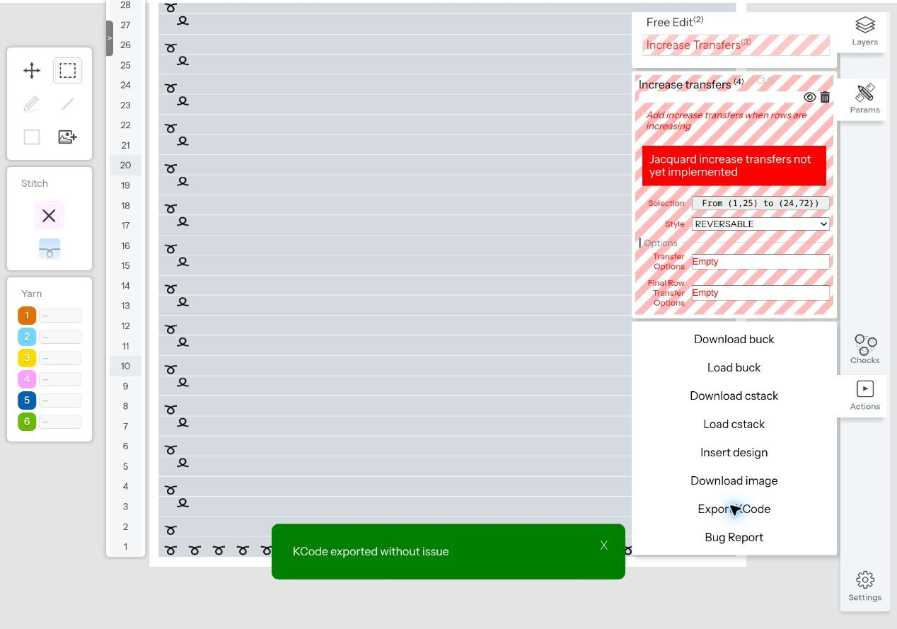

# Customist debugging captures

Small, controlled vendor exports for investigating machine encoding and
construction. These are raw observations, not approved machine trials or new
members of the canonical `packages/machine-lib/reference/atlas.json` corpus.
Do not edit the captured `.kc` bytes or infer physical success from an export.

## Captured on 2026-11-12

`2026-11-12/manifest.json` pins two files, their cloud designs, settings and
SHA-256 hashes. Both use the same front-bed C3 rectangle, cleared to widen
22 → 23 → 24 needles over three eight-row bands. Only the increase style
changes: Simple versus Fashioned (default Fashion-Mark Width 4).

Each has 28 exported design rows but **32 machine passes**. Yarn-fed
`<< Tr-Rl 3 300 450` occurs at one-based passes 8 and 20 (zero-based exported
row comments 7 and 17). These are useful encoding witnesses, not yet a complete
semantic or topology audit. There is no cast-on or bind-off. In particular,
do not run these body-only files from an empty machine bed.

The original buck and cstack downloads are now preserved beside each `.kc`,
with hashes in the manifest. Uploads resumed on November 13 after the user
enabled file URL access for the Chrome extension. The full-selection controls
below reproduce both original machine instruction streams exactly (excluding
the filename comment).

The selection was columns 2–24, rows 1–24; column 1 was excluded by the UI
selection. The moving right boundary is included. The November 13 comparison
found no instruction difference from full selection. `command (14).kc` was byte-identical
to the Simple capture and is intentionally not duplicated here.

## Why these cases come next

Read the latest issue comments as well as the original brief:

- [#18 shaping trial](https://github.com/xjhc/kniterate-studio/issues/18):
  [latest two-sample report](https://github.com/xjhc/kniterate-studio/issues/18#issuecomment-6842455924)
  distinguishes visible edge appearance from unconfirmed loop-capture defects;
  the photograph shows only one face of each specimen. The reversible pickup
  mechanism is not the single-bed split mechanism. A split capture alone does
  not establish a reversible solution.
- [#18 feeder investigation](https://github.com/xjhc/kniterate-studio/issues/18#issuecomment-6806679961):
  repeated idle C1/C6 moves during widening require separate lifecycle evidence.
- [#19 trim](https://github.com/xjhc/kniterate-studio/issues/19): structural joins,
  both-face appearance and moving boundaries must be evaluated separately.
- [#9 machine handoff](https://github.com/xjhc/kniterate-studio/issues/9): retain
  start/left-edge observations; do not schedule another bind-off-only physical
  trial by default.

## Captured on 2026-11-13

`2026-11-13/manifest.json` pins **19 additional exports**, authored inputs,
downloaded source stacks, screenshots and full pass reports from Studio's
existing `passes --detail` decoder. Run `python fixtures/customist-debug/verify.py`
to check artifact hashes and the controlled comparisons. This is capture and
decoder evidence, not topology qualification, controller acceptance or knitting.

| Family | Captures | Observed result |
| --- | --- | --- |
| Single bed | Left/right × phase 0/1 × untreated/Simple/Fashioned: 12 | Phase 0 uses yarn-fed `<< Tr-Rl`; shifting both events one row uses `>> Tr-Rr`. Extra passes depend on side and style; see manifest. |
| Reversible baseline/borders | Rectangular/shaped × Close off/on: 4 | Genuine C3/C4 inverse colour assignments on both beds. Close changes edge bed ownership. |
| Reversible increase | 1 refusal/fallback | Increase transfers v1.3.0, style `REVERSABLE` (2): **“Jacquard increase transfers not yet implemented.”** Export still reports success; every instruction equals the shaped untreated control. |
| Feeder start/body | Retract Feeders off/on: 2 | Waste + cast on v2.1.0; C6 waste, C1 draw, C3 widening body. Checkbox state verified. Files differ only in filename comment. No top-waste section. |

The single-bed input is 24 rows wide at most 24 needles. Phase 0 has widths
22/23/24 for 8/8/8 rows; phase 1 for 9/8/7 rows. Left cases mirror the cleared
columns. Increase selection covers the full canvas; Fashioned uses default
width 4. Front C3 defaults are speed 300, roller 450, stitch 6. The decoder uses
zero-based needle coordinates; machine pass numbers are one-based.

Reversible fixtures include a 24-row plain C3 prelude, then a 24-design-row
inverse two-colour block (48 yarn rows, plus carrierless movement passes).
The four central columns use C4 on front/C3 on rear; the background is inverse.
The block uses speed 400, roller 450, stitch 7. Shaping clears needles after
the birdseye command to make 22/23/24-needle bands. **Close runs before this
trim**, so these captures do not establish a join following a moving edge:
the trim removes the right join in the narrow band. The importer discarded
PNG alpha; the PNG alone does not reproduce shaping.

The downloaded `raw/session.cstack.json` contains multiple canvases, including
exploratory ones. The manifest identifies the exact canvas for each capture;
the earlier right-control snapshot is separate because that canvas was later
edited. Import appends canvases. The scratch cloud design was repeatedly
renamed and is mutable; local hashed files are the durable evidence.
`inputs/` are authored variations of vendor commands, **not vendor exports**.
Their cached `outputs`/`code` came from the original envelope and are stale:
Customist reports a code mismatch during import, then regenerates the commands.
Use the downloaded output files for analysis. The refusal input initially uses
Simple; the UI selection of REVERSABLE is recorded in the downloaded stack.

Two experiments remain under `rejected/`: a one-needle birdseye insertion,
and a second Waste + cast on intended to add top waste. The latter returns C6
but repeats body afterward, so it is not the intended clean lifecycle pair.
Its off version was exported; its on input was only prepared. Neither belongs
in the controlled set. No machine file here has a qualified finish or has
been knitted; body-only files have no cast-on.

Still open: clean start/body/top-waste C6-return off/on, Fashioned width 2
versus 4, rear split primitives, and physical/both-face evidence. The refusal
establishes only that REVERSABLE on this two-colour jacquard base fails.
Fabric and style both changed from the working single-bed Simple case, so this
does not isolate either variable. Simple on the same jacquard base and
REVERSABLE on the single-bed base are the first follow-up controls. A one-colour
two-bed base is also untested. Kniterate's older reversible sleeve construction
remains separate evidence; no general absence of two-bed increases follows.

Further captures: both edges widening in one row (Simple/Fashioned), and
isolated left/right single-bed decreases followed by the jacquard decrease.

The two screenshots have their top 48 pixels cropped to remove account details.
Only the working-tree images are sanitized; the originals remain in commit
`4174c8d`. A later crop commit does not remove them from Git history. Do not
treat these branch commits as sanitized for public publication.

## Capture queue and coverage

Use paired files changing one factor. Keep each base and command stack. The
November 13 section above records completed coverage and the remaining gaps;
this table retains the rationale for the broader queue.

| Priority | Case family | Controlled comparison and question |
| --- | --- | --- |
| 0 | Source recovery and control | Download buck and cstack for both saved designs; screenshot settings. Export the identical stepped base without Increase transfers. Check full selection versus columns 2–24. |
| 1 | Increase direction and side | Simple/Fashioned at left edge; shift event cadence by one row to exercise the other carriage direction. Both-edge case only after isolated edges. Do modes, racking and target needles mirror correctly? |
| 1 | Fashioned width | Same right-edge case at widths 2 and 4, within UI-supported limits. Separate placement from loop-creation behavior. |
| 1 | Reversible increase availability | On a genuine two-colour, two-bed base, try the UI's `REVERSABLE` option. Preserve any error or unchanged output as evidence. A single-bed selection is not a valid reversible test. Compare with `reference/sleeves.kc`. |
| 1 | Reversible side joins | Same small two-colour rectangle with Borders/Close off/on, then a one-sided stepped version if supported. Record inner/outer yarn ownership, command order and both-face previews. Compare with `reference/dbj.kc` and the successful paisley baseline. |
| 1 | Feeder lifecycle | Identical complete start/body/top-waste design with Retract feeders off/on, if exposed. Keep bed position fixed; include widening and C6 return. Compare C1/C6 movement, gripper operations and return anchoring. |
| 2 | Split primitives | Front/rear split, both travel directions, with established parent loops; isolate from ordinary carrierless transfer. Does decoding preserve parent/new-loop identity? |
| 2 | Decrease and reversal | Single-bed simple/fashioned decreases, then valid two-bed decreases; isolated left/right first. Follow with one increase-to-decrease turning point and odd/even widths. |
| 2 | Backing and colour transitions | Two-colour birdseye MINIMAL/FULL/invert where offered, then a third colour entering/leaving. Hold motif, settings and border constant. |
| 3 | Start/finish options | Controlled cast-on, first-row roller and finish-option exports only where an unresolved issue requires them. Reuse existing references before adding variants; this is not a request for more physical bind-off trials. |

For options not observed in this session, confirm the current UI supports them
before making a fixture. Do not manufacture a vendor output or interpret a menu
entry as an implementation guarantee. Capture failed/unsupported cases too.

## Capture contract

Each case should retain:

1. Stable ID, question, control ID and the single intended difference.
2. Original `.kc`, editable buck/cstack exports, cloud design URL, capture date,
   command versions/order, settings screenshot and front/rear preview when relevant.
3. Exact dimensions, bed placement, direction, carrier assignments, shape schedule,
   stitch/speed/roller/rack settings, defaults left untouched, and selection bounds.
4. Byte length and SHA-256 for every artifact; one-based machine-pass event map
   separately from design rows and zero-based vendor row comments.
5. Observed export outcome, decoded operations, loop/transfer findings, movements,
   gripper operations and semantic diff against its control. Record unknowns.
6. Independent statuses for captured, decoded, regression-covered, controller
   accepted and physically knitted. Physical records require the exact file hash,
   setup, interventions and both-face photographs; never promote from UI success.

Before changing the compiler, inspect the emitted events with the existing
machine-file CLI/audit tools. Add focused assertions to the existing parity and
topology machinery once semantics are understood; keep expected refusals explicit.
Admit captures into the canonical corpus deliberately, with its required proof
checks, rather than silently changing the existing 13-file reference baseline.

This collection does not change compiler behavior, release status or physical
registry entries. It records vendor behavior to guide a later implementation.
